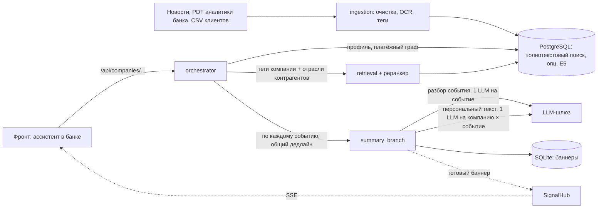

# Альфа Инсайты

Персональные новостные инсайты для руководителей компаний-клиентов прямо в интернет-банке Альфа-Бизнес.
Это не лента новостей: ассистент в правой панели банка отвечает на вопрос «что из происходящего касается
именно моей компании и почему».

- **Баннеры-сигналы** — что произошло, почему это касается этой компании, где источник. Важность: «Внимание»,
  «Наблюдения», «Возможность».
- **Чат** — вопрос ассистенту с ответом по новостям и аналитике банка; помнит короткий контекст диалога.
- **Плашки** — короткий сигнал у объектов на страницах платежей и контрагентов.

Новость связывается с компанией через данные банка, а не через упоминание названия:

- ОКВЭД, регион, продукты банка, страны ВЭД;
- **платёжный граф**: в каких отраслях поставщики и покупатели компании и какая у каждой отрасли доля потока;
- группа и связанные компании;
- **роль сотрудника**: собственник, финансовый директор, казначей, закупки, продажи видят разные акценты.

В каждом ответе отдельно размечены факт, позиция банка, вывод модели и гипотеза. Утверждения проверяются
по источникам без LLM: числа, направление изменения («повысил»/«снизил»), единицы и масштаб, названия
организаций, опора выводов. Не прошедший проверку ответ генерируется заново с замечаниями, а при низкой
уверенности клиент видит только новость со ссылкой. Если статья не скачана и есть только анонс или заголовок,
источник так и подписан.



## Запуск с нуля

Инструкция проверена на чистом клоне: пустая БД, пустой `data/processed`. Все данные лежат в репозитории
(`data/raw/`), дамп БД не нужен.

### Что нужно

| | |
|---|---|
| Docker | Docker Desktop (Windows, macOS) или Docker Engine с Compose v2 (Linux) |
| [uv](https://docs.astral.sh/uv/) | только чтобы отдать статику фронта; Python ставить не нужно |
| Диск | около 4 ГБ: образ бэкенда 1,7 ГБ, PostgreSQL 0,5 ГБ, БД 0,5 ГБ, модели и кэш 0,5 ГБ |
| Порты | `5432` (БД), `8000` (бэкенд), `5173` (фронт) на `127.0.0.1`; меняются в `.env` |
| Время | первая сборка данных около 25 минут на CPU: OCR PDF ~3 мин, разметка новостей ~15 мин |
| Сеть | при первой сборке: образы Docker, зависимости, модель разметки (Hugging Face) |

Команды выполняются из корня клона и одинаковы в bash и PowerShell.

### 1. Настройки

```bash
cp .env.example .env          # PowerShell: Copy-Item .env.example .env
```

В `.env` задайте свой `POSTGRES_PASSWORD` и тот же пароль в `DATABASE_URL`.
`API_KEY` — ключ LLM-шлюза кейса. Без ключа (`API_KEY=` пустой) работает детерминированная заглушка:
интерфейс и сценарии те же, тексты шаблонные. Пишите `KEY=value` без пробелов вокруг `=`.
Если порт `5432` занят, задайте другой `POSTGRES_PORT` и поправьте порт в `DATABASE_URL`.

### 2. База данных и данные (один раз)

```bash
docker compose up -d --wait db
docker compose build ingest
docker compose run --rm ingest init-db
docker compose run --rm ingest prepare-csv
docker compose run --rm ingest load-csv
docker compose run --rm ingest extract-pdfs --metadata data/reports-metadata.json
docker compose run --rm ingest prepare-news
docker compose run --rm ingest tag-chunks
docker compose run --rm ingest load-pdfs
docker compose run --rm ingest load-news
docker compose run --rm ingest load-news --source data/raw/reports/news.jsonl
docker compose run --rm ingest load-news --source data/raw/reports/news_combined.jsonl --include-partial
docker compose run --rm --entrypoint python ingest -m scripts.build_tags --from-db
```

Что делают последние команды:

- `load-news` без `--source` — фрагменты новостей и PDF для поиска по аналитике банка (`rag_chunks`);
- `load-news --source …news.jsonl` — полные статьи для ленты и чата (`news_articles`);
- `load-news --source …news_combined.jsonl --include-partial` — 41 тыс. заголовков и анонсов (`news_briefs`);
- `build_tags` — `data/processed/company_tags.csv`, профили компаний для бэкенда.

Повтор любой команды безопасен: готовые результаты берутся из кэша, загрузка в БД не дублирует записи.
Ожидаемые количества строк и диагностика: [docs/database.md](docs/database.md).

### 3. Бэкенд

```bash
docker compose up -d --build orchestrator
curl http://127.0.0.1:8000/health             # {"status":"ok"}; Swagger: http://127.0.0.1:8000/docs
```

### 4. Фронт

```bash
uv run python -m http.server 5173 --bind 127.0.0.1 -d src/frontend
```

Откройте **http://127.0.0.1:5173/login.html?api=http&base=http://127.0.0.1:8000**.

Первый запрос по компании отдаёт новости сразу, готовые баннеры от LLM приходят через несколько секунд
и заменяют их без перезагрузки. Без `?api=http` фронт работает на встроенном моке, без бэкенда.

### Демо-доступ

На странице входа выберите компанию и сотрудника в блоке «Демо-доступ» или введите телефон сотрудника из этого
блока и пароль **`demo2026`**. В меню пользователя можно сменить сотрудника или компанию.
Компании взяты из датасета кейса, названия и люди вымышлены.

| ID | Компания | Деятельность | Сотрудники |
|---|---|---|---|
| U_1941 | ТД «Арсанта» | оптовая торговля, импорт | генеральный, закупки и ВЭД, казначей, коммерческий |
| U_106783 | Гелиотрон | производство электрооборудования | генеральный, финансовый, закупки и ВЭД, главбух |
| U_201985 | Кварталис-Верх | жилищное строительство | собственник, финансовый, закупки и ВЭД, коммерческий |
| U_191099 | Тракт-Бридж | дорожное строительство | собственник, генеральный, казначей, главбух, закупки |
| U_20244 | Ковыль | оптовая торговля зерном, Новосибирск | собственник, закупки и ВЭД, казначей, коммерческий |
| U_11496 | Невский Мультимодал | логистика, Санкт-Петербург | генеральный, финансовый, закупки и ВЭД |

Собственник Кварталис-Верх и Тракт-Бридж — один человек (холдинг): после входа он переключается между
компаниями. Прямая ссылка без входа: `/?api=http&base=http://127.0.0.1:8000&company=U_201985&role=cfo`.

### Остановить и запустить снова

```bash
docker compose stop                           # данные сохраняются
docker compose up -d db orchestrator          # следующий запуск, без пересборки данных
```

`docker compose down -v` удаляет БД: после него нужно повторить шаг 2.

### Если что-то не так

| Симптом | Что сделать |
|---|---|
| `ports are not available` | занят порт: задать `POSTGRES_PORT` / `ORCHESTRATOR_PORT` в `.env` |
| Баннеры: «нет подходящих новостей» | не загружены статьи: `load-news --source data/raw/reports/news.jsonl` |
| Бэкенд: «нет файла тегов» | выполнить `build_tags` из шага 2, затем `docker compose restart orchestrator` |
| `build_tags`: `Is a directory` | бэкенд запускали раньше `build_tags`, и Docker создал папку `data/processed/company_tags.csv`: остановить бэкенд, удалить эту папку, повторить `build_tags` |
| Фронт: ошибка CORS | открыть фронт на `127.0.0.1:5173` или добавить свой origin в `CORS_ORIGINS` |
| Тексты баннеров шаблонные | не задан `API_KEY`: работает заглушка LLM |

Остальное: [docs/database.md](docs/database.md#если-запуск-не-получился).

## Как получается баннер

1. **Старт сессии.** Фронт вызывает `GET /signals`. Оркестратор читает теги и досье компании: профиль,
   поставщиков и покупателей по отраслям, связанные компании. Переводы «себе» (внутри группы и через общих
   физлиц) исключаются.
2. **Поиск.** Новости ищутся по тегам компании и по отраслям её ключевых контрагентов, реранкер выбирает
   top-k событий с учётом роли сотрудника. Статьи об одном плановом событии (решение по ставке, инфляция)
   за один день собираются в одно событие, и баннер строится по нескольким статьям.
3. **Генерация по каждому событию, параллельно.**
   1. Если баннер этой компании и роли по событию уже есть, он отдаётся из хранилища.
   2. Иначе ветка разбирает событие: факты и карта влияния на отрасли. Разбор общий для всех клиентов
      и кэшируется; материалы банка к нему подбираются только по теме события.
   3. Детерминированно строятся пути влияния на компанию: своя отрасль, кредит и ставка, ВЭД, регион,
      поставщики, покупатели, связанные компании.
   4. Считается уверенность.
   5. Если уверенность высокая, пишется короткий персональный текст и проверяется без LLM. Если низкая —
      баннер содержит только новость.
4. **Срок.** Не успевшее к дедлайну (`BANNER_SLO_S`, 3,5 с) событие приходит как «только новость»,
   готовый баннер прилетает по SSE и заменяет его.

Чат идёт тем же путём, но ищет по словам вопроса, учитывает две последние пары реплик и ничего не кэширует.
Подробности: [docs/architecture.md](docs/architecture.md).

## Данные

| Источник | Объём | Где используется |
|---|---|---|
| CSV клиентов (`data/raw/users`) | 85 513 компаний, 1,35 млн платежей, 12 514 связей физлиц | профиль, платёжный граф, группы |
| Новости (`news.jsonl`) | 5 878 полных статей | лента и чат |
| Новости (`news_combined.jsonl`) | плюс 41 399 заголовков и анонсов | лента и чат с пометкой, RAG |
| PDF аналитики банка (`data/raw/reports`) | 9 отчётов, 64 страницы | позиция банка в баннерах и чате |

## Локальная разработка

Окружение Python управляется только через `uv`.

```bash
uv sync --extra ml                            # + E5, cross-encoder и зависимости ингеста
set -a; . ./.env; set +a                      # локальный процесс не читает .env сам
uv run python -m orchestrator
uv run pytest                                 # unit- и API-тесты; с БД: RUN_DB_TESTS=1 uv run pytest
uv run python scripts/demo_summary_branch.py  # ветка саммари без БД
```

```
src/backend/
  ingestion/        CSV, PDF, новости -> PostgreSQL, теги       domain / application / infrastructure / interfaces
  retrieval/        поиск новостей и материалов банка, события   domain / application / infrastructure / interfaces
  orchestrator/     сценарии баннеров и чата, HTTP, SSE, WS      domain / application / infrastructure / api
  summary_branch/   разбор события, пути влияния, валидация, хранилище баннеров
  evaluation/       метрики ретрива
src/frontend/       ассистент в оболочке интернет-банка, ES-модули без сборки
tests/  sql/  scripts/  eval/  docs/
```

### Переменные окружения

| Переменная | По умолчанию | Назначение |
|---|---|---|
| `POSTGRES_PASSWORD`, `POSTGRES_PORT`, `DATABASE_URL` | —, 5432 | доступ к БД |
| `API_KEY`, `LLM_BASE_URL`, `LLM_MODELS_BANNER`, `LLM_MODELS_CHAT` | — | LLM-шлюз |
| `LLM_MODE` | `gateway` при `API_KEY`, иначе `fake` | `gateway`, `fake` (детерминированный LLM) или `template` (шаблон без ветки) |
| `BANNER_SLO_S`, `CHAT_SLO_S` | 3.5, 6.0 | дедлайны сценариев |
| `ORCHESTRATOR_PORT` | 8000 | порт бэкенда в Docker |
| `BANNER_STORE_PATH` | `data/cache/banners.db` | SQLite с баннерами (в Docker — volume `banner-store`) |
| `CORS_ORIGINS` | `http://127.0.0.1:5173,http://localhost:5173` | origin фронта |
| `NEWS_BRIEFS` | `1` | `0` убирает из ленты и чата заголовки и анонсы |
| `NEWS_SEARCH_MODE`, `NEWS_CANDIDATE_LIMIT` | `lexical`, 80 | `local_semantic` включает E5 и cross-encoder ([docs/retrieval.md](docs/retrieval.md)) |
| `DEMO_COMPANY_ID` | — | компания для `demo-company` во фронте |
| `COMPANY_TAGS_PATH`, `REPORTS_PATH` | `data/processed/company_tags.csv`, `data/raw/reports` | теги компаний и PDF аналитики |

### API

Вход фронта — `/api/companies/{company_id}/...` с необязательным `?role=`:
`signals` (баннеры), `signals/stream` (SSE), `signals/inline` (плашки), `seen` / `suppress` / `dismiss`
(реакции), `chat` (вопрос). Контракт: [docs/api-contract.md](docs/api-contract.md).
Внутренний API ядра (`/v1/...`, WebSocket `/v1/ws` со стримом шагов трассы): [docs/orchestrator.md](docs/orchestrator.md).

## Ограничения

- Демо-вход — макет: пароль общий, проверки доступа сотрудника к `company_id` на бэкенде нет.
- Склейка событий работает для плановых макрособытий; остальные новости объединяются только
  при совпадении заголовка. Почему так: [docs/retrieval.md](docs/retrieval.md#события).
- Правила валидации подобраны и измерены на синтетической порче ответов
  ([src/backend/summary_branch/METRICS.md](src/backend/summary_branch/METRICS.md),
  [eval/results/REPORT.md](eval/results/REPORT.md)); ручная разметка в работе.
- Ответы не являются инвестиционной рекомендацией.

## Документация

| Файл | О чём |
|---|---|
| [docs/architecture.md](docs/architecture.md) | слои, порты, поток баннера и чата, план масштабирования |
| [docs/api-contract.md](docs/api-contract.md) | контракт фронт ↔ бэк |
| [docs/database.md](docs/database.md) | сборка БД с нуля, проверка, обновление, диагностика |
| [docs/ingestion.md](docs/ingestion.md), [docs/tagging.md](docs/tagging.md), [docs/tags.md](docs/tags.md) | очистка, OCR, разметка, словарь тегов |
| [docs/news-combined.md](docs/news-combined.md) | объединённый набор новостей: заголовки и анонсы, `--include-partial`, `--dry-run`, `--news-only` |
| [docs/retrieval.md](docs/retrieval.md), [docs/orchestrator.md](docs/orchestrator.md) | поиск новостей и события, оркестратор |
| [src/backend/summary_branch/README.md](src/backend/summary_branch/README.md) | ветка саммари: уверенность, валидация, хранилище |
| [src/frontend/README.md](src/frontend/README.md) | фронт: запуск, экраны, демо-вход, моки |
| [docs/c4.md](docs/c4.md) | C4-модель (Structurizr DSL) и генерация диаграмм |
