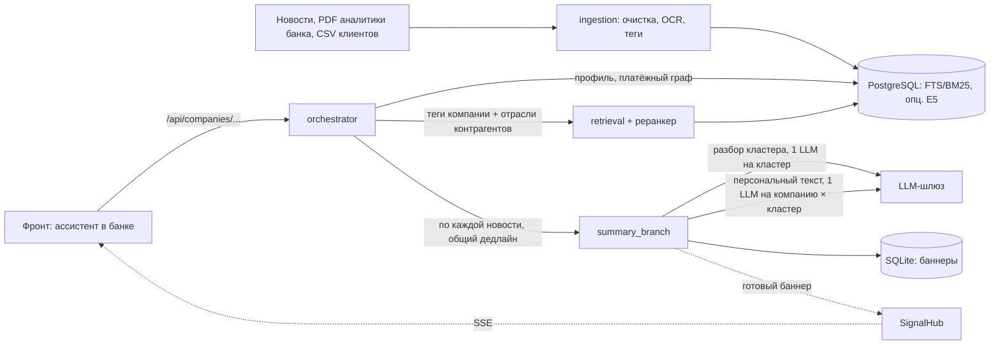

# Альфа Инсайты

Персональные новостные инсайты для руководителей компаний-клиентов прямо в интернет-банке Альфа-Бизнес. Это не лента новостей. Ассистент в правой панели банка показывает:

- **баннеры-сигналы** — что произошло, почему это касается именно этой компании, где источник;
- **чат** с аналитикой банка;
- **плашки** у объектов на страницах платежей и контрагентов.

Новость связывается с компанией через данные банка, а не через упоминание названия:

- ОКВЭД;
- продукты банка;
- страны ВЭД;
- регион;
- **платёжный граф**: в каких отраслях поставщики и покупатели компании и какая у каждой отрасли доля потока;
- группа и связанные компании.

Факт, позиция банка, вывод модели и гипотеза в ответах размечены отдельно.



## Как получается баннер

1. **Старт сессии.** Фронт вызывает `GET /signals`. Оркестратор читает теги и досье компании: профиль, поставщиков и покупателей по отраслям, связанные компании. Переводы «себе», то есть внутри группы и через общих физлиц, исключаются.
2. **Поиск.** Новости ищутся по тегам компании и по отраслям её ключевых контрагентов, затем реранкер выбирает top-k.
3. **Генерация по каждой новости, параллельно.**
   1. Если баннер этой компании по кластеру уже есть (прошлые сессии), он отдаётся из хранилища.
   2. Иначе ветка разбирает кластер: факты и карту влияния на отрасли. Этот разбор общий для всех клиентов и кэшируется.
   3. Детерминированно строятся пути влияния на компанию: своя отрасль, кредит и ставка, ВЭД, регион, поставщики, покупатели, связанные компании.
   4. Считается уверенность.
   5. Если уверенность высокая, пишется короткий персональный текст и проверяется без LLM: числа только из источников, ссылка на путь влияния, без советов. Если низкая — баннер содержит только новость.
4. **Срок.** Не успевшая к дедлайну (`BANNER_SLO_S`, по умолчанию 3,5 с) новость приходит как «только новость», а готовый баннер прилетает по SSE и заменяет её.

Чат идёт тем же путём, но генерирует по правилам чата и ничего не кэширует. Подробности: [docs/architecture.md](docs/architecture.md).

## Структура

```
src/
  backend/
    ingestion/        CSV, PDF, новости -> PostgreSQL, теги
    retrieval/        поиск новостей и материалов банка, E5 и cross-encoder (опционально)
    orchestrator/     DDD: domain, application (сценарии), infrastructure (адаптеры), api (HTTP, SSE, WS)
    summary_branch/   DDD: разбор кластера, пути влияния, персональный текст, валидация, хранилище баннеров
    evaluation/       метрики ретрива
  frontend/           ассистент в оболочке интернет-банка, чистые ES-модули
tests/                тесты бэкенда (tests/summary_branch — ветка саммари)
sql/                  схема БД
scripts/              сборка тегов и профилей, оценка, демо
eval/                 синтетический датасет и отчёты оценки ветки саммари
docs/                 архитектура, контракт API, сборка БД, C4
```

## Быстрый старт

Нужны [uv](https://docs.astral.sh/uv/) и Docker. Окружение Python управляется только через `uv`.

```bash
cp .env.example .env                      # пароль БД; API_KEY для LLM-шлюза (без ключа работает детерминированная заглушка)
docker compose up -d db
docker compose run --rm ingest init-db    # затем загрузка данных: docs/database.md
uv run python -m scripts.build_tags --from-db
```

Бэкенд в Docker: один образ на ингест и оркестратор, torch ставится один раз.

```bash
docker compose up -d --build orchestrator          # http://127.0.0.1:8000/docs
```

Локально без Docker:

```bash
uv sync                                     # основные зависимости; + --extra ml для E5, cross-encoder и ингеста
uv run python -m orchestrator
```

Фронт:

```bash
uv run python -m http.server 5173 --bind 127.0.0.1 -d src/frontend
# http://127.0.0.1:5173/?api=http&base=http://127.0.0.1:8000&company=<synthetic_u>
```

Без `?api=http` фронт работает на встроенном моке. Если в `.env` задан `DEMO_COMPANY_ID`, можно не передавать `company`.

## Переменные окружения

| Переменная | По умолчанию | Назначение |
|---|---|---|
| `POSTGRES_PASSWORD`, `DATABASE_URL` | — | доступ к БД |
| `API_KEY`, `LLM_BASE_URL`, `LLM_MODELS_BANNER`, `LLM_MODELS_CHAT` | — | LLM-шлюз ветки саммари |
| `LLM_MODE` | `gateway` при `API_KEY`, иначе `fake` | `gateway`, `fake` (детерминированный LLM) или `template` (шаблон без ветки) |
| `BANNER_SLO_S`, `CHAT_SLO_S` | 3.5, 6.0 | дедлайны сценариев |
| `BANNER_STORE_PATH` | `data/cache/banners.db` | SQLite с баннерами (в Docker — volume `banner-store`) |
| `DEMO_COMPANY_ID` | — | компания для `demo-company` во фронте |
| `CORS_ORIGINS` | `http://127.0.0.1:5173,http://localhost:5173` | origin фронта |
| `NEWS_SEARCH_MODE`, `NEWS_CANDIDATE_LIMIT` | `lexical`, 80 | `local_semantic` включает E5 и cross-encoder ([docs/retrieval.md](docs/retrieval.md)) |
| `COMPANY_TAGS_PATH`, `REPORTS_PATH` | `data/processed/company_tags.csv`, `data/raw/reports` | теги компаний и PDF аналитики |

## API

Вход фронта — `/api/companies/{company_id}/...`:

- `signals` — баннеры и счётчики;
- `signals/stream` — SSE;
- `signals/inline` — плашки;
- `seen`, `suppress`, `dismiss` — реакции на баннер;
- `chat` — вопрос ассистенту.

Контракт: [docs/api-contract.md](docs/api-contract.md). Внутренний API ядра (`/v1/...`, WebSocket `/v1/ws` со стримом шагов трассы) описан в [docs/orchestrator.md](docs/orchestrator.md).

## Проверка

```bash
uv run pytest                               # unit- и API-тесты; тесты с БД: RUN_DB_TESTS=1
uv run python scripts/demo_summary_branch.py
```

Оценка ветки саммари: [eval/results/REPORT.md](eval/results/REPORT.md). Метрики ретрива: [docs/retrieval.md](docs/retrieval.md).

## Документация

| Файл | О чём |
|---|---|
| [docs/architecture.md](docs/architecture.md) | слои, порты, поток баннера и чата, план масштабирования: WebSocket, триггер БД, BFF |
| [docs/api-contract.md](docs/api-contract.md) | контракт фронт ↔ бэк |
| [docs/database.md](docs/database.md) | сборка БД с нуля, проверка, обновление |
| [docs/ingestion.md](docs/ingestion.md), [docs/tagging.md](docs/tagging.md), [docs/tags.md](docs/tags.md) | очистка, OCR, разметка, словарь тегов |
| [docs/news-combined.md](docs/news-combined.md) | объединённый набор `news_combined.jsonl`: заголовки и анонсы (`--include-partial`), `--dry-run`, `--news-only` |
| [docs/retrieval.md](docs/retrieval.md), [docs/orchestrator.md](docs/orchestrator.md) | поиск новостей, оркестратор |
| [src/backend/summary_branch/README.md](src/backend/summary_branch/README.md) | ветка саммари: уверенность, валидация, хранилище |
| [src/frontend/README.md](src/frontend/README.md) | фронт: запуск, экраны, моки |
| [docs/c4.md](docs/c4.md) | C4-модель (Structurizr DSL) и генерация диаграмм |
