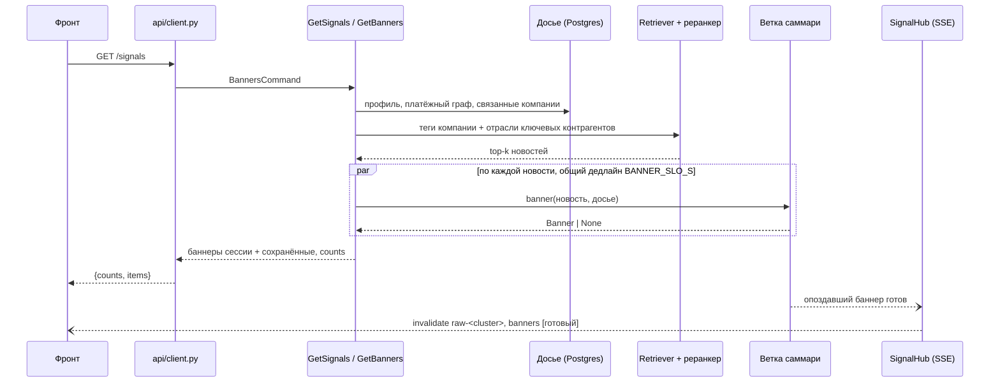
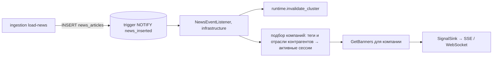

# Архитектура бэкенда

Один Python-проект (`pyproject.toml`, `uv.lock`) и один Docker-образ. Пакеты лежат в `src/backend`, фронт — в `src/frontend`.

| Пакет | Ответственность | Слои |
|---|---|---|
| `ingestion` | CSV, PDF, новости → PostgreSQL, теги чанков и новостей | скрипты загрузки |
| `retrieval` | поиск новостей (FTS/BM25, опционально E5), контекст из аналитики банка, cross-encoder | адаптеры портов оркестратора |
| `orchestrator` | сценарии сессии и чата, досье компании, клиентский API, события | `domain`, `application`, `infrastructure`, `api` |
| `summary_branch` | разбор кластера, пути влияния, персональный текст, валидация, хранилище баннеров | `domain`, `application`, `infrastructure`, `bootstrap.py` |
| `evaluation` | метрики ретрива | утилита |

Зависимости направлены внутрь: `api`/`infrastructure` → `application` → `domain`. Composition root один: `orchestrator/main.py`. Ветка саммари собирается своим `summary_branch/bootstrap.py`, а `orchestrator/main.py` его вызывает.

## Сессия: баннеры

Внутри `branch.banner`:

1. **Хранилище компании.** Баннер этой компании по кластеру уже есть (прошлые сессии) → отдаётся сразу. Скрытый компанией не пересобирается.
2. **Разбор кластера.** Один вызов LLM на кластер для всех клиентов, кэш по `(cluster, prompt_version)`. Результат — факты с доказательствами и карта влияния по отраслям ОКВЭД (`impacts`), странам и регионам. Проверка без LLM: числа, обоснованность, источники. Невалидный ответ генерируется ещё раз. Параллельные сессии одного кластера ждут одну генерацию.
3. **Пути влияния** (`domain/exposure.py`, детерминированно): карта влияния сопоставляется с досье компании.
   - своя отрасль;
   - продукт банка: кредит и ставка;
   - чувствительность профиля: ВЭД и курс, штат и рынок труда, потребительский спрос;
   - страна ВЭД;
   - регион;
   - **поставщики** и **покупатели** по долям платёжного потока; переводы внутри группы и между компаниями с общими физлицами исключены;
   - связанные компании.

   Пути через контрагентов помечаются как гипотезы.
4. **Уверенность.** Эвристика по обоснованности, источникам и свежести плюс «шумное ИЛИ» весов путей. Решение: саммари, саммари с пометкой, только новость или не показывать.
5. **Персональный текст.** Короткий вызов LLM по фактам кластера и путям влияния компании. Проверка: числа только из фактов и путей, ссылка на путь, без советов и без «вашего кредита» у не-клиентов. Если проверка не пройдена или LLM недоступна, текст собирается из лучшего пути без LLM.
6. **Сохранение и отправка.** Баннер сохраняется в SQLite и уходит подписчикам через `SignalSink`.

Стоимость: LLM вызывается один раз на кластер плюс по одному персональному вызову на пару (компания, кластер). Пара появляется только для top-k новостей активной сессии и затем кэшируется.

Задержка. p95 ограничивает дедлайн, а не скорость LLM: новость, не успевшая к сроку, уходит как «только новость» и заменяется по SSE.

## Чат

`AnswerChat` использует тот же поиск и то же досье. Если вопрос задан из баннера, поиск идёт по заголовку его новости. Пути влияния попадают в промпт как признаки компании. Генерация идёт по правилам чата: до трёх утверждений, последнее — вывод именно для этой компании. Ответ не кэшируется. При низкой уверенности возвращается сама новость.

## Порты оркестратора

| Порт | Реализация | Назначение |
|---|---|---|
| `ProfileRepository` | `infrastructure/profiles_csv.py` | теги компании |
| `CompanyDossierSource` | `infrastructure/postgres_dossier.py` | профиль, платёжный граф, связанные компании (только чтение) |
| `NewsRetriever`, `EventRetriever`, `Reranker` | `retrieval/interfaces/orchestrator_ports.py`, `domain/ranking.py` | новости и контекст аналитики банка |
| `SummaryBranch` | `infrastructure/summary_branch_adapter.py` | баннер по новости, ответ чата |
| `BannerFeed` | `infrastructure/summary_branch_adapter.py` | сохранённые баннеры и реакции |
| `SignalSink`, `SignalStream` | `infrastructure/signal_hub.py` | события открытой сессии |

## Слои пакетов retrieval и ingestion

Оба пакета разложены так же, как оркестратор: зависимости направлены только внутрь (`interfaces`, `infrastructure` -> `application` -> `domain`). Порты (Protocol) лежат в `application/ports.py`, реализации в `infrastructure/`.

| Слой | `retrieval/` | `ingestion/` |
|---|---|---|
| `domain` | нормализация запроса, правила тег -> FTS-фраза (`search_rules`), потребности ретрива (`needs`), правила контекста события (`event_rules`), ключ дедупликации (`headlines`), проверка URL материалов (`bank_materials`), рецепт эмбеддингов (`embedding`) | таксономия, словарь и правила тегов (`tagging`, `taxonomy`), нарезка текста (`chunking`), правила CSV (`csv_rules`), проверка документа (`document_rules`), URL, HTML и RSS новостей (`news_urls`, `news_html`, `news_feeds`) |
| `application` | поиск новостей (`news_search`), контекст события (`event_context`), локальная лента (`local_feed`), переранжирование (`rerank`), индекс эмбеддингов (`semantic_index`), поиск по отчётам (`document_search`) | по одному модулю на сценарий: `prepare_csv`, `extract_pdfs`, `prepare_news`, `tag_artifacts`, `load_documents`, `load_news_snapshot`, `collect_news`, `archive_crawl`, `audit_snapshot` |
| `infrastructure` | PostgreSQL (`postgres_news`, `postgres_documents`, `postgres_embeddings`, `postgres_activity`), E5 (`e5_encoder`), cross-encoder (`cross_encoder`), проверка PDF на диске (`report_files`) | PostgreSQL (`postgres`), Tesseract, PyMuPDF, urllib-загрузчик, SQLite-состояние обхода и кэш тегов, sentence-transformers, файловое хранилище артефактов |
| `interfaces` | `orchestrator_ports.py` (реализации портов оркестратора), `library.py` (`retrieve`), CLI | CLI `python -m ingestion`, CLI сборщиков новостей, `composition.py` (сборка зависимостей) |

Команды `python -m ingestion ...`, `python -m ingestion.news_data|news_archive|news_audit`, `python -m retrieval`, `python -m retrieval.semantic|reranker` не изменились: одноимённые модули верхнего уровня только вызывают CLI из `interfaces/`.

## Масштабирование (план, не реализовано)

Сценарии не зависят от транспорта и источника триггера. Расширения добавляют адаптеры к существующим портам, а слои `application` и `domain` не меняются.

### WebSocket для чата

- `/v1/ws` уже принимает `{type: "banners" | "chat"}` и стримит шаги трассы.
- Следующий шаг — стрим токенов ответа. Для этого у LLM-клиента появится потоковый метод, а `ChatAnswer` будет собираться из частей.
- Подписка `SignalStream` подключается к тому же сокету. Тогда одна сессия получает в одном соединении и баннеры, и ответы чата.
- SSE остаётся запасным каналом: у фронта он уже есть.

### Триггер от БД на новую новость

- Триггер `AFTER INSERT` на `insights.news_articles` вызывает `pg_notify('news_inserted', news_id)`. Слушатель в процессе оркестратора держит `LISTEN`. Схема таблиц не меняется, добавляются только функция и триггер.
- Новость того же кластера снимает старые баннеры: `invalidate_cluster` пишет `invalidate` клиентам.
- Компании подбираются по обратному индексу «тег отрасли → компании». Прямые теги берутся из `company_tags.csv`, отрасли контрагентов — из досье. Начинать с компаний с открытой сессией: `SignalHub.subscribers`. Остальным баннер соберётся при следующем входе.
- Разбор кластера можно прогревать сразу, он общий для всех. Персональный шаг выполняется только для онлайн-клиентов, в пределах бюджета LLM.
- При нескольких репликах `SignalHub` заменяется адаптером к Redis Pub/Sub или NATS с тем же портом. Хранилище баннеров переезжает с SQLite на Postgres или Redis: порт `BannerStore` уже описан.

### BFF

- `api/client.py` выносится в отдельный сервис: авторизация, сессия пользователя и роль, агрегация под F1 (оболочка), F2 (ассистент) и F3 (консоль команды).
- BFF ходит в ядро по `/v1` (REST и WS) и подписывается на события ядра через очередь.
- Ядро остаётся без пользовательского состояния. Контракт фронта ([api-contract.md](api-contract.md)) не меняется: фронт его не заметит.
