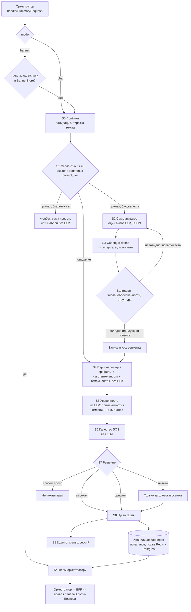

# Ветка «саммари → баннеры → уверенность → выдача»: data-flow

Код сущностей и интерфейсов лежит рядом: `models.py`, `interfaces.py`, `scoring.py`. Сводка по блоку и внедрению: `README.md`. Здесь описано, как данные проходят через ветку и почему всё устроено так.

## 1. Границы ветки

Вход приходит от оркестратора одним вызовом `branch.handle(request)`: баннер или сообщение чата выбираются по `mode`. Оркестратор результат не оценивает и не повторяет: валидация и повтор генерации целиком внутри ветки. Выход оркестратор отдаёт во фронт Альфа-Бизнеса через BFF. Поиск, реранкер и классификатор в нашу зону не входят.

Контракт входа (`SummaryRequest`): всегда приходят три вещи, ещё две необязательны.

1. Вопрос чата `question`. Опционально: есть только в режиме `chat`, в режиме `banner` его быть не должно.
2. Контекст компании `CompanyContext`: `company_id`, `segment_id`, `role`, машинные `tags`, человекочитаемые `features` и, главное, `profile` (`CompanyProfile`): сырой профиль в терминах данных организаторов (отрасль ОКВЭД, штат, стадия, регион, отношение с банком, продукты, внешнеторговая деятельность и страны, негативный флаг, агрегаты платёжного графа). Из профиля ветка сама выводит чувствительность к темам, теги и признаки «для вас» (раздел 5). Без профиля работают только `tags` и `features`.
3. Батч новостей от реранкера `news[]`: топ-K по убыванию оценки, у каждой новости есть `cluster_id`, `rerank_score`, `source_kind` (primary, bank или media), теги (в том числе отраслевые `okved:46`, `metal`, `retail`) и ссылки.
4. Пользователь `user` (`user_id`, `role`), необязательно: кто спрашивает. Без него роль берётся из `company.role`. Роль попадает в промпт.
5. `bank_materials[]` (тезисы аналитики банка с номерами страниц) и `budget` (режим: full, lite, cached_only).

Выход: в режиме `banner` список баннеров `Banner` (по одному на кластер из батча для каждой компании сегмента), в режиме `chat` один `ChatAnswer`. Содержимое баннера (утверждения, источники) лежит в кэше сегмента и подтягивается при сборке `BannerDTO`.

## 2. Сквозной поток

### Стадии

| Стадия | Что происходит | Токены |
|---|---|---|
| S0 Приёмка | Проверка контракта (`SummaryRequest`), обрезка текстов новостей по длине, склейка дублей по `cluster_id`. Текст новости считается данными, не инструкциями. | нет |
| S1 Кэш | Ключ `(cluster_id, segment_id, prompt_version)`. Попадание означает, что LLM не нужна. | нет |
| S2 Саммаризатор | Один вызов LLM со структурным выводом `SummaryDraft`: заголовок, шаблон строки «для вас» со слотом `{feature}` и запасной вариант, тема, severity, список утверждений с типами и ссылками на источники. Модель берёт `LLMClient`, то есть общий роутер с бюджетом. | да, основное |
| S2а Валидация | `ValidatedGenerator`: структура цела, любое число утверждения есть в источнике, у каждого fact/bank не менее половины основ слов совпадает с источником, обоснованность фактов не ниже 0.6. Невалидное генерируется заново, до `max_generation_attempts` (2) при бюджете `full`; если валидной попытки нет, дальше идёт лучшая. | да, повтор S2 |
| S3 Привязка доказательств | Детерминированно: ссылки превращаются в цитаты, факты без опоры отбрасываются, дубли схлопываются, источники собираются так, чтобы первоисточник и «Альфа-Банк» шли вместе. Сразу после этого считаются сигналы сегмента (обоснованность, источники, SQS), результат попадает в кэш. | нет (правила) |
| S4 Персонализация | `personalization.enrich` добавляет к тегам и признакам компании выведенные из профиля. В шаблон «для вас» подставляется признак компании (`render_for_you`); если подходящего признака нет или текст говорит о продуктах банка не клиенту, берётся запасной текст. Это подстановка, не генерация. `severity` и тема приходят из саммари сегмента. | нет |
| S5 Уверенность | См. раздел 5. Считается на каждую компанию, но сигналы сегмента берутся готовыми из кэша. | нет |
| S6 Качество | См. раздел 6. | нет |
| S7 Решение | По уверенности: показывать саммари, показывать с пометкой, показывать только новость или не показывать. | нет |
| S8 Публикация | Запись баннера в хранилище, SSE-пуш, если баннер срочный. После этого `handle` читает готовые баннеры компании запроса из хранилища и отдаёт оркестратору. | нет |

Ключевая идея: дорогая часть (S2) зависит от пары «новость × сегмент», а не от компании. Всё, что зависит от компании (S4, S5, S6), считается без LLM.

## 3. Два режима

**Баннеры (`mode=banner`).** Считаются заранее, чат не нужен. Пользователь на странице не ждёт модель.

**Чат (`mode=chat`).** Всё в реальном времени, ничего не заготавливается. Отличия от баннера: в S2 промпт получает вопрос, S1 использует кэш только на уровне claims кластера (чтобы не извлекать факты заново, а переиспользовать), ответ не пишется в хранилище баннеров, а уходит напрямую в `ChatAnswerDTO`. Уверенность и качество считаются тем же кодом. Невалидный ответ перегенерируется внутри ветки (S2а); если уверенность всё равно низкая, ответ превращается в «вот сама новость и ссылка» (`raw_news`). Оркестратор ничего не повторяет.

## 4. Как баннеры оказываются на странице сразу

Задача: пользователь открывает Альфа-Бизнес, и лучшие баннеры уже есть. Решение состоит из четырёх частей.

### 4.1 Предрасчёт по сегментам, а не по компаниям

Три триггера:

1. **По событию.** Пришла новая важная новость, и оркестратор запускает поиск и ранжирование. Мы получаем батч и генерируем сегментное саммари только для сегментов, у которых релевантность выше порога.
2. **По расписанию.** Ночной прогрев: для активных клиентов пересчитываются баннеры, которых нет или срок которых истекает за ближайшие часы.
3. **Ленивый прогрев при входе.** Если у компании пусто или всё просрочено, возвращаем лучшее из сегментного кэша, а свежий расчёт запускаем в фоне.

Число вызовов LLM равно (число важных кластеров в сутки) × (число сегментов), а не числу компаний. Точное число зависит от нарезки сегментов. Рекомендуемое правило даёт `personalization.segment_signature`: какие из четырёх тем (ставка, курс, труд, спрос) важны компании и кто она для банка (клиент, потенциальный клиент, бывший клиент). На профилях организаторов (85 513 компаний) это 40 сегментов, 10 крупнейших покрывают 85%. Отрасль и регион в сегмент не входят: они подставляются в «для вас» и в оценку уверенности на уровне компании, поэтому саммари остаётся общим.

Открытый вопрос к владельцу оркестратора: в режиме предрасчёта он должен вызывать нас по одному представителю сегмента, а мы разворачиваем результат на всех активных компаний сегмента через S4. Если он будет вызывать нас по каждой компании, кэш всё равно сработает, но лишних запросов будет много.

### 4.2 Кэш и хранилище: две разные вещи

`SummaryCache` хранит общее содержимое по ключу (кластер, сегмент, версия промпта): его дорого считать, и оно одинаково для всех компаний сегмента. `BannerStore` хранит личный индекс: баннер компании с готовой выдачей и состоянием (показан, скрыт). Первое отвечает на вопрос «что сказать», второе на вопрос «кому и в каком порядке показать». Подробнее в `SPEC.md`, раздел 2.

Реализация хранилища баннеров:

- Сейчас: локальное хранилище без внешней БД. `InMemoryBannerStore` (ОЗУ) или `SqliteBannerStore` (один файл SQLite, баннеры и состояния «показан»/«скрыт» переживают перезапуск). Топ-3 считается по баннерам одной компании (`pick_top_k`), выборка по индексу `company_id`.
- Позже при росте нагрузки: Postgres как источник истины и Redis (отсортированное множество `banners:{company_id}`, score равен приоритету) за тем же интерфейсом `BannerStore`.
- Для каждой записи есть `expires_at`: просрочка сама убирает баннер из выдачи.

### 4.3 Приоритет и выбор

`priority = вес_severity × confidence × свежесть × новизна`

- Вес severity: внимание 1.0, возможность 0.8, наблюдение 0.7.
- Свежесть: экспоненциальный спад, период полураспада зависит от темы (курс быстрее, ставка медленнее).
- Новизна: уже показанный баннер получает множитель 0.4.
- Из топ-кандидатов жадно набираем 3 с разнообразием по темам: повтор темы получает штраф 0.5. Реализовано в `pick_top_k`.

Чтение должно занимать десятки миллисекунд; целевое значение я бы взял p95 < 100 мс на `GET /signals`, но это цель, а не измерение.

### 4.4 Обновление и снятие

- Свежее событие в том же кластере заменяет старый баннер: `BranchRuntime.invalidate_cluster` сбрасывает кэш сегмента и баннеры кластера, следующий прогон пересобирает саммари.
- Нажали «не про меня» или «неточно»: баннер скрывается у этой компании (`suppress`), а сигнал уходит в обратную связь, чтобы снижать приоритет кластера для сегмента.
- Срочный баннер (высокая уверенность, severity «внимание») пушится по SSE в уже открытые сессии, чтобы не ждать перезагрузки.
- Холодный старт: у новой компании нет персональных баннеров, поэтому берём лучшие сегментные.

## 5. Персонализация и уверенность

LLM-судьи нет, NLI не применяем. Уверенность в баннере отвечает на два независимых вопроса:

1. **Верно ли сказано** (одинаково для всех компаний сегмента): обоснованность, источники, состав утверждений. Считается один раз на сегмент (`content_signals`).
2. **Касается ли этой компании и актуально ли** (разное для каждой компании): релевантность по профилю и свежесть. Считается без токенов (`company_confidence`).

### 5.1 Профиль → чувствительность к темам

`personalization.topic_exposure(profile)` даёт для каждой темы значение 0–1 и причины (правила стартовые, экспертные):

| Тема | Правило |
|---|---|
| ставка | у клиента банка есть кредит, лизинг или факторинг → 1.0; стройка/недвижимость (разделы 41, 42, 43, 68) → 0.6; депозит у клиента → 0.6; иначе 0.2 |
| курс | внешнеторговая деятельность → 1.0; оптовая торговля (46) → 0.4; иначе 0.1 |
| труд | штат от 101 → 1.0; 16–100 и зарплатный проект → 0.6; иначе 0.3 |
| спрос | розница, общепит, услуги населению → 0.8; иначе 0.4 |

Продукты банка учитываются только у клиентов (`relationship=client`): у потенциального клиента их наличие неизвестно. Внешнеторговая деятельность считается заданной, если есть флаг или страны. Платёжный граф даёт `indirect_exposure`: доля контрагентов из отраслей новости × 0.5 (граф приходит агрегатами, без идентификаторов и сумм). Отрасль новости определяют теги `okved:NN` и отраслевые слова (`metal`, `agro`, `retail`, `it`, `logistics`).

### 5.2 Релевантность и сигналы

| Сигнал | Как считается | Вес |
|---|---|---|
| Релевантность компании | с профилем: 0.35 × оценка реранкера + 0.45 × чувствительность к теме (или отраслевое совпадение, или косвенная связь, берётся наибольшее) + 0.10 × отрасль/косвенная связь + 0.10 × регион (новость про другой регион даёт 0); без профиля: 0.6 × реранкер + 0.4 × пересечение тегов | 0.30 |
| Обоснованность (grounding) | Для каждого утверждения fact/bank: 0.6 × доля чисел, найденных в источнике, + 0.4 × доля основ слов, найденных в источнике | 0.35 |
| Качество источника | Первоисточник 1.0, банк 0.9, СМИ 0.6 | 0.15 |
| Свежесть | Спад по теме (период полураспада) | 0.10 |
| Состав утверждений | Выводы модели и гипотезы без опоры в источнике снижают оценку | 0.10 |

Итог — взвешенное геометрическое среднее: один плохой компонент тянет всю оценку вниз.

Предохранители, которые срабатывают независимо от формулы:

- число из утверждения не найдено в источнике (любое; числа словами нормализуются) → не выше 0.5;
- у fact/bank-утверждения меньше половины основ слов совпадает с источником → не выше 0.5;
- нет ни одного источника → баннера нет;
- релевантность ниже 0.25 → не выше 0.45;
- **компания не чувствительна к теме** (чувствительность ниже `EXPOSURE_FLOOR=0.5`, косвенной связи нет) → не выше 0.45, то есть показывается только заголовок и ссылка; в чате порог не применяется, потому что вопрос задал сам пользователь;
- у компании негативный флаг, а баннер типа «возможность» → не выше 0.74 (только с пометкой).

Пороги: ≥ 0.75 высокая (саммари), 0.55–0.75 средняя (с пометкой «проверьте источник»), ниже 0.55 низкая (только заголовок и ссылка).

Каждая оценка сопровождается причинами (`reasons`) для трассы и консоли, в том числе «компания не чувствительна к теме «rate»». В `ConfidenceComponents.personal_fit` пишется чувствительность к теме.

**Компромисс порога `EXPOSURE_FLOOR`.** Компания, не чувствительная к теме, получает не пустое место, а `show_raw_news`: только заголовок и ссылка, без саммари и строки «для вас». Порог 0.5 выбран в пользу персонализации: шум 23% при 2 упущенных из 97 парах «касается напрямую», но на базе организаторов полноценный баннер получают около 28% пар. Порог 0.25 даёт 52% полноценных баннеров, но шум 42%. Значение меняется одной константой в `scoring.py` и требует продуктового решения.

### 5.3 «Для вас» без выдуманных фактов о клиенте

Модель не пишет факты о компании: она пишет шаблон со слотом `{feature}`, а признак подставляет код из `features` (выведенных из профиля или пришедших от оркестратора). Дополнительно `render_for_you` не пропускает текст вида «ваш кредит», «у вас лизинг» компании, которая не клиент: подставляется запасной текст, а если и он говорит о продуктах, строка пустая. В промпт идут только роль, теги и признаки; идентификаторы компании, сегмента и группы, выручка в рублях, контрагенты и суммы не идут (тест `test_prompt_with_profile_has_derived_facts_but_no_ids_groups_or_counterparties`).

### 5.4 Что проверено и чего нет

На синтетических профилях и переразметке (`eval/results/REPORT.md`, раздел 4): при описании компании тегами баннер показывался во всех парах с меткой «не касается» (шум 100%), по профилю шум 23% при упущенных 2 из 97 парах «касается напрямую». На 2000 профилях организаторов × 28 новостей баннер получают около 28% пар, остальным показывается заголовок: это следствие порога, а не ошибка (36% компаний не чувствительны ни к одной макро-теме). Метки реакции пользователей отсутствуют, правила и веса предварительные. Известные пробелы: валюта новости не сопоставляется со странами торговли компании (считается, что ВЭД важен для любого курса); смысл `CLOSE_CLIENT` и продуктов у потенциальных клиентов не описан; нужны отраслевые теги новостей, иначе для нечувствительных компаний лента состоит из заголовков.

**Калибровка.** Размеченных реакций нет. Нужны 100–150 пар «баннер → нормально / нет» и сигналы `mark_seen`/`suppress` («не про меня»), по ним калибруются веса и порог чувствительности; результат подключается как `calibrator`.

**NLI не применяем:** вычисления ограничены. Подмена смысла (те же числа и слова, но «повысил» вместо «снизил») правилами не ловится, её ограничивает промпт: новость пересказывается теми же лексемами, выводы только обоснованные и помечены как model/hypothesis.

## 6. Метрика качества саммари (SQS)

Нужно различать две вещи. Уверенность отвечает на вопрос «можно ли это показывать этому клиенту сейчас». SQS отвечает на вопрос «насколько хорош текст саммари». Первое влияет на решение в рантайме, второе нужно для сравнения промптов и моделей и для консоли.

`SQS = 0.45·faithfulness + 0.25·coverage + 0.15·specificity + 0.15·brevity`, при условии, что пройден вентиль структуры (иначе 0).

| Компонент | Что измеряет | Как считается |
|---|---|---|
| faithfulness | Доля утверждений fact/bank, подтверждённых источником | grounding ≥ 0.6 |
| coverage | Сохранены ли ключевые факты новости | Числа из заголовка и первых двух предложений новости найдены в саммари |
| specificity | Есть ли привязка к компании | В шаблоне «для вас» есть слот `{feature}` |
| brevity | Укладывается ли текст в формат баннера | Заголовок ≤ 60, «для вас» ≤ 140 символов |
| Вентиль структуры | Формальная корректность | Есть заголовок, источник, хотя бы один факт, у каждого fact/bank есть цитата |

Онлайн-метрики поверх SQS (из обратной связи и логов): доля «полезно», доля «не про меня», доля «неточно» (основной сигнал по худшему классу ошибок), раскрытие баннера в чат.

Оговорка: SQS считается эвристиками без LLM, поэтому он ловит выдуманные числа и неполноту, но не ловит тонкие смысловые искажения. Для них нужна ручная выборка и обратная связь.

## 7. Бюджет и деградация

Токены тратятся только в S2. Режим из `budget.tier` управляет поведением:

- `full` — обычный режим;
- `lite` — короткое саммари, один вызов, без повторов;
- `cached_only` — LLM не зовём: берём кэш сегмента или показываем только новость и ссылку.

Всё остальное (S4–S8) работает без токенов, поэтому деградация не ломает выдачу.

## 8. Что нужно согласовать с соседними ветками

1. Оркестратор: в предрасчёте вызывает нас по сегменту или по компании (раздел 4.1).
2. Профили: оркестратор присылает `CompanyProfile` и `UserContext`; нужно согласовать имена полей, кто считает `PaymentProfile` (агрегаты графа), кто чистит данные (повторяющиеся идентификаторы, заглушка выручки 1000), и использовать `segment_signature` как правило `segment_id`.
   Новости: отраслевые теги `okved:NN` от реранкера/классификатора.
3. BFF: форматы `BannerDTO` и `ChatAnswerDTO`, SSE-канал для пуша.
4. Трасса: нужен общий `trace_id` на весь запрос, чтобы в консоли сошлась цепочка шагов.
5. Разметка для калибровки: кто и когда размечает 100–150 пар.
6. Допустимость передачи банковских данных во внешний шлюз LLM: сейчас в промпт уходят только производные признаки.
