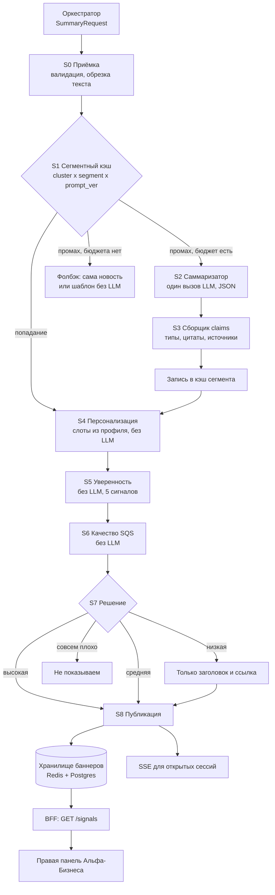

# Ветка «саммари → баннеры → уверенность → выдача»: data-flow

Код сущностей и интерфейсов лежит рядом: `models.py`, `interfaces.py`, `scoring.py`. Сводка по блоку и внедрению: `README.md`. Здесь описано, как данные проходят через ветку и почему всё устроено так.

## 1. Границы ветки

Вход приходит от оркестратора. Выход уходит в BFF и дальше во фронт Альфа-Бизнеса. Поиск, реранкер и классификатор в нашу зону не входят.

Контракт входа (`SummaryRequest`): всегда приходят три вещи.

1. Вопрос чата `question`. Опционально: есть только в режиме `chat`, в режиме `banner` его быть не должно.
2. Контекст компании `CompanyContext`: `company_id`, `segment_id`, `role`, машинные `tags` (отрасль, макрофакторы, география) и человекочитаемые `features` («3 кредитных продукта»).
3. Батч новостей от реранкера `news[]`: топ-K по убыванию оценки, у каждой новости есть `cluster_id`, `rerank_score`, `source_kind` (primary, bank или media) и ссылки.

Вместе с этим оркестратор может передать `bank_materials[]` (тезисы аналитики банка с номерами страниц) и `budget` (остаток в рублях и режим: full, lite, cached_only).

Выход: в режиме `banner` список баннеров `Banner` (по одному на кластер из батча для каждой компании сегмента), в режиме `chat` один `ChatAnswer`. Содержимое баннера (утверждения, источники) лежит в кэше сегмента и подтягивается при сборке `BannerDTO`.

## 2. Сквозной поток

### Стадии

| Стадия | Что происходит | Токены |
|---|---|---|
| S0 Приёмка | Проверка контракта (`SummaryRequest`), обрезка текстов новостей по длине, склейка дублей по `cluster_id`. Текст новости считается данными, не инструкциями. | нет |
| S1 Кэш | Ключ `(cluster_id, segment_id, prompt_version)`. Попадание означает, что LLM не нужна. | нет |
| S2 Саммаризатор | Один вызов LLM со структурным выводом `SummaryDraft`: заголовок, шаблон строки «для вас» со слотом `{feature}` и запасной вариант, тема, severity, список утверждений с типами и ссылками на источники. Модель берёт `LLMClient`, то есть общий роутер с бюджетом. | да, основное |
| S3 Привязка доказательств | Детерминированно: ссылки превращаются в цитаты, факты без опоры отбрасываются, дубли схлопываются, источники собираются так, чтобы первоисточник и «Альфа-Банк» шли вместе. Сразу после этого считаются сигналы сегмента (обоснованность, источники, SQS), результат попадает в кэш. | нет (правила) |
| S4 Персонализация | В шаблон «для вас» подставляется признак компании (`render_for_you`); если подходящего признака нет, берётся запасной текст. Это подстановка, не генерация. `severity` и тема приходят из саммари сегмента. | нет |
| S5 Уверенность | См. раздел 5. Считается на каждую компанию, но сигналы сегмента берутся готовыми из кэша. | нет |
| S6 Качество | См. раздел 6. | нет |
| S7 Решение | По уверенности: показывать саммари, показывать с пометкой, показывать только новость или не показывать. | нет |
| S8 Публикация | Запись баннера в хранилище, SSE-пуш, если баннер срочный. | нет |

Ключевая идея: дорогая часть (S2) зависит от пары «новость × сегмент», а не от компании. Всё, что зависит от компании (S4, S5, S6), считается без LLM.

## 3. Два режима

**Баннеры (`mode=banner`).** Считаются заранее, чат не нужен. Пользователь на странице не ждёт модель.

**Чат (`mode=chat`).** Всё в реальном времени, ничего не заготавливается. Отличия от баннера: в S2 промпт получает вопрос, S1 использует кэш только на уровне claims кластера (чтобы не извлекать факты заново, а переиспользовать), ответ не пишется в хранилище баннеров, а уходит напрямую в `ChatAnswerDTO`. Уверенность и качество считаются тем же кодом. Если уверенность низкая, ответ превращается в «вот сама новость и ссылка» (`raw_news_fallback`), либо оркестратор повторяет поиск.

## 4. Как баннеры оказываются на странице сразу

Задача: пользователь открывает Альфа-Бизнес, и лучшие баннеры уже есть. Решение состоит из четырёх частей.

### 4.1 Предрасчёт по сегментам, а не по компаниям

Три триггера:

1. **По событию.** Пришла новая важная новость, и оркестратор запускает поиск и ранжирование. Мы получаем батч и генерируем сегментное саммари только для сегментов, у которых релевантность выше порога.
2. **По расписанию.** Ночной прогрев: для активных клиентов пересчитываются баннеры, которых нет или срок которых истекает за ближайшие часы.
3. **Ленивый прогрев при входе.** Если у компании пусто или всё просрочено, возвращаем лучшее из сегментного кэша, а свежий расчёт запускаем в фоне.

Число вызовов LLM равно (число важных кластеров в сутки) × (число сегментов), а не числу компаний. Точное число зависит от того, как вы нарежете сегменты. Предлагаю 10–30 сегментов (отрасль × размер × регионный кластер). Стоимость вы измерите на реальных ценах после первых прогонов.

Открытый вопрос к владельцу оркестратора: в режиме предрасчёта он должен вызывать нас по одному представителю сегмента, а мы разворачиваем результат на всех активных компаний сегмента через S4. Если он будет вызывать нас по каждой компании, кэш всё равно сработает, но лишних запросов будет много.

### 4.2 Кэш и хранилище: две разные вещи

`SegmentCache` хранит общее содержимое по ключу (кластер, сегмент, версия промпта): его дорого считать, и оно одинаково для всех компаний сегмента. `BannerStore` хранит личный индекс: баннер компании с готовой выдачей и состоянием (показан, скрыт). Первое отвечает на вопрос «что сказать», второе на вопрос «кому и в каком порядке показать». Подробнее в `SPEC.md`, раздел 2.

Реализация хранилища баннеров:

- **Postgres** — источник истины: все баннеры со всеми полями, историей и трассой.
- **Redis**, отсортированное множество на компанию: `banners:{company_id}`, score равен приоритету, значение равно `banner_id`; сами баннеры хранятся хешами. Чтение топ-3 — один запрос порядка O(log n).
- Для каждой записи есть `expires_at`: просрочка сама убирает баннер из выдачи.

### 4.3 Приоритет и выбор

`priority = вес_severity × confidence × свежесть × новизна`

- Вес severity: внимание 1.0, возможность 0.8, наблюдение 0.7.
- Свежесть: экспоненциальный спад, период полураспада зависит от темы (курс быстрее, ставка медленнее).
- Новизна: уже показанный баннер получает множитель 0.4.
- Из топ-кандидатов жадно набираем 3 с разнообразием по темам: повтор темы получает штраф 0.5. Реализовано в `pick_top_k`.

Чтение должно занимать десятки миллисекунд; целевое значение я бы взял p95 < 100 мс на `GET /signals`, но это цель, а не измерение.

### 4.4 Обновление и снятие

- Свежее событие в том же кластере заменяет старый баннер: `BranchRuntime.invalidate_cluster` сбрасывает кэш сегмента и баннеры кластера, следующий прогон пересобирает саммари.
- Нажали «не про меня» или «неточно»: баннер скрывается у этой компании (`suppress`), а сигнал уходит в обратную связь, чтобы снижать приоритет кластера для сегмента.
- Срочный баннер (высокая уверенность, severity «внимание») пушится по SSE в уже открытые сессии, чтобы не ждать перезагрузки.
- Холодный старт: у новой компании нет персональных баннеров, поэтому берём лучшие сегментные.

## 5. Уверенность

LLM-судьи нет. Уверенность считается из пяти дешёвых сигналов (`scoring.company_confidence`).

| Сигнал | Как считается | Вес |
|---|---|---|
| Релевантность компании | 0.6 × оценка реранкера + 0.4 × пересечение тегов компании и новости | 0.30 |
| Обоснованность (grounding) | Для каждого утверждения типа fact/bank: 0.6 × доля чисел, найденных в источнике, + 0.4 × доля основ слов, найденных в источнике. Необязательно усредняется с NLI-классификатором | 0.35 |
| Качество источника | Первоисточник 1.0, банк 0.9, СМИ 0.6 | 0.15 |
| Свежесть | Спад по теме | 0.10 |
| Состав утверждений | Выводы модели и гипотезы без опоры в источнике снижают оценку | 0.10 |

Итог — взвешенное геометрическое среднее: один плохой компонент тянет всю оценку вниз, чего не делает среднее арифметическое.

Жёсткие предохранители, которые срабатывают независимо от формулы:

- число из утверждения не найдено в источнике → оценка не выше 0.5;
- нет ни одного источника → баннер не показываем;
- релевантность ниже 0.25 → оценка не выше 0.45.

Пороги: ≥ 0.75 высокая (показываем саммари), 0.55–0.75 средняя (саммари с пометкой «проверьте источник»), ниже 0.55 низкая (показываем только заголовок и ссылку, без интерпретации).

Каждая оценка сопровождается списком причин (`reasons`), который идёт в трассу и в консоль эксперта.

**Калибровка.** Пока размеченных данных нет, веса и пороги стартовые. Чтобы их настроить, команде стоит разметить вручную 100–150 пар «баннер → нормально / нет» и обучить на пяти компонентах логистическую регрессию или изотоническую калибровку. Её результат подключается как `calibrator`. Дальше калибровку можно подпитывать кнопками обратной связи.

**NLI.** Проверка «источник влечёт утверждение» небольшим классификатором повышает точность. В коде он необязательный: передаётся в `DefaultContentScorer`.

## 6. Метрика качества саммари (SQS)

Нужно различать две вещи. Уверенность отвечает на вопрос «можно ли это показывать этому клиенту сейчас». SQS отвечает на вопрос «насколько хорош текст саммари». Первое влияет на решение в рантайме, второе нужно для сравнения промптов и моделей и для консоли.

`SQS = 0.45·faithfulness + 0.25·coverage + 0.15·specificity + 0.15·brevity`, при условии, что пройден вентиль структуры (иначе 0).

| Компонент | Что измеряет | Как считается |
|---|---|---|
| faithfulness | Доля утверждений fact/bank, подтверждённых источником | grounding ≥ 0.6 |
| coverage | Сохранены ли ключевые факты новости | Числа из заголовка и первых двух предложений новости найдены в саммари |
| specificity | Есть ли привязка к компании | В шаблоне «для вас» есть слот `{feature}` |
| brevity | Укладывается ли текст в формат баннера | Заголовок ≤ 60, «для вас» ≤ 140 символов |
| Вентиль структуры | Формальная корректность | Есть заголовок, источник, хотя бы один факт, у каждого fact/bank есть цитата |

Онлайн-метрики поверх SQS (из обратной связи и логов): доля «полезно», доля «не про меня», доля «неточно» (основной сигнал по худшему классу ошибок), раскрытие баннера в чат.

Оговорка: SQS считается эвристиками без LLM, поэтому он ловит выдуманные числа и неполноту, но не ловит тонкие смысловые искажения. Для них нужна ручная выборка и обратная связь.

## 7. Бюджет и деградация

Токены тратятся только в S2. Режим из `budget.tier` управляет поведением:

- `full` — обычный режим;
- `lite` — короткое саммари, один вызов, без повторов;
- `cached_only` — LLM не зовём: берём кэш сегмента или показываем только новость и ссылку.

Всё остальное (S4–S8) работает без токенов, поэтому деградация не ломает выдачу.

## 8. Что нужно согласовать с соседними ветками

1. Оркестратор: в предрасчёте вызывает нас по сегменту или по компании (раздел 4.1).
2. Классификатор и профили: кто выдаёт `segment_id` и по какому правилу.
3. BFF: форматы `BannerDTO` и `ChatAnswerDTO`, SSE-канал для пуша.
4. Трасса: нужен общий `trace_id` на весь запрос, чтобы в консоли сошлась цепочка шагов.
5. Разметка для калибровки: кто и когда размечает 100–150 пар.
